

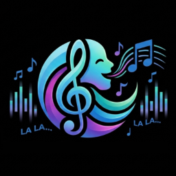

# Vocalis

**A MIDI/KAR karaoke player for macOS, Windows and Linux, inspired by vanBasco, built for live karaoke nights.**
Run the show from your computer, show full-screen lyrics on a monitor or TV, and let singers book their turn from their phones.

[🇮🇹 Italiano](README.md) · 🇬🇧 English

[**⬇️ Download the latest version**](../../releases/latest) · [🌐 App website](https://www.enricofanucchi.com/en/app/vocalis?utm_source=github&utm_campaign=readme) · [💜 Support the project](https://github.com/sponsors/kikoz85)

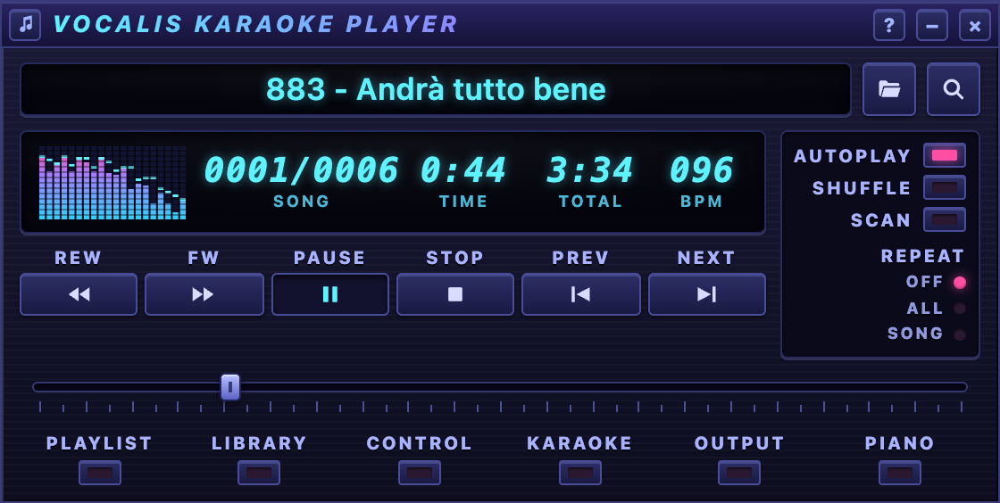

> The app interface is in **English and Italian**: it follows your system language, or pick it in *Setup → General → Language*. The screenshots below show the Italian interface.

---

## Contents

- [Why Vocalis](#why-vocalis)
- [Download and installation](#download-and-installation)
- [Features](#features)
- [Screenshots](#screenshots)
- [Themes](#themes)
- [Getting started](#getting-started)
- [Keyboard shortcuts](#keyboard-shortcuts)
- [Reporting a problem](#reporting-a-problem)
- [Support Vocalis](#support-vocalis)
- [Credits and licensing](#credits-and-licensing)

## Why Vocalis

`.mid` and `.kar` karaoke files are tiny, can be transposed with no quality loss, and already contain synchronized lyrics. Vocalis plays them through a built-in synthesizer and follows the layout of classic players such as vanBasco: small windows you can arrange side by side, LCD displays, faders and a 16-channel mixer. The graphics are modern and can be changed with themes.

The priorities are **speed and reliability**: fast startup, glitch-free audio and instant search across libraries of thousands of songs.

**Vocalis is free.** If you find it useful, you can [support its development](#support-vocalis).

## Download and installation

Installers are on the [**Releases**](../../releases/latest) page.

| System | File | Notes |
|---|---|---|
| **macOS** 10.15+ — Apple Silicon (M1, M2, M3, M4…) | `Vocalis_x.y.z_aarch64.dmg` | Open the DMG and drag Vocalis to Applications. |
| **macOS** 10.15+ — Intel | `Vocalis_x.y.z_x64.dmg` | Open the DMG and drag Vocalis to Applications. |
| **Windows** 10/11 (64-bit) | `Vocalis_x.y.z_x64-setup.exe` or `.msi` | Standard installer or MSI. |
| **Windows 11 on ARM** (ARM64) | `Vocalis_x.y.z_arm64-setup.exe` or `.msi` | Snapdragon X, Surface Pro, Windows in Parallels on Macs. |
| **Linux** (x86_64 and ARM64) | `.deb` (Debian/Ubuntu), `.rpm` (Fedora/openSUSE) or `.AppImage`: `amd64`/`x86_64` for Intel/AMD PCs, `arm64`/`aarch64` for ARM (e.g. 64-bit Raspberry Pi) | For the AppImage: make it executable and run it. |

> **First launch.** The installers are not yet signed with an Apple/Microsoft certificate, so the system asks for confirmation the first time.
> - **macOS**: if you see «cannot verify the developer», go to *System Settings → Privacy & Security* and click **Open Anyway**.
> - **Windows**: if SmartScreen appears, click *More info* → **Run anyway**.

Vocalis already includes a complete General MIDI SoundFont: it plays out of the box, with no setup.

## Features

### Playback
- **MIDI** (`.mid`, `.midi`, `.rmi`) and **KAR** (`.kar`) files, opened by double-click, drag and drop, or from the library.
- **Built-in SoundFont synthesizer**, with **GeneralUser GS** included.
- **Roland GS / Yamaha XG fidelity**: Vocalis reads the settings stored in the files (reverb, chorus, drum kits on any channel) and plays them the way their authors intended.
- **SoundFont download manager**: a catalog of 8 karaoke-friendly banks (FluidR3, MuseScore General, Shan SGM and more), with integrity checks and pause/resume.
- **Key** (transpose in semitones), **tempo** and **volume**, with presets saved per song.
- **MIDI Out to DAWs and instruments** (Ableton Live, Logic Pro, Cubase, FL Studio, Reaper, Bitwig, GarageBand…): the whole song goes out on the MIDI port you choose, with all 16 channels, SysEx, transposition and the Vocalis mixer already applied. A virtual port (IAC Driver on macOS, loopMIDI on Windows, ALSA on Linux) is all you need to play the backing track with your own virtual instruments, record it or process it in your DAW. It can also go to an external sound module or keyboard, or to the system synth. There is also **MIDI input** from a keyboard, with **Live mode** to play along with the backing track.
- **Native MicTune integration**: Vocalis finds MicTune's port by itself and reconnects if MicTune is opened later, restarted or updated. It sends the melody (channel 4) and the backing vocals for harmonies (channel 5), in sync with the audio coming out of the speakers, plus the song's key, BPM and transposition (MicTune Link). Vocal correction then follows the song's actual notes instead of a fixed scale.
- **Backing vocals detected and handled separately**: Vocalis finds the backing-vocal channels in the MIDI or KAR file by itself, from the track name («Cori», «Choir», «Backing», «BV», «Harmony»…) or the General MIDI vocal instrument (Choir Aahs, Voice Oohs, Synth Voice). It sends them on a channel separate from the melody's (channel 5 for MicTune), so the harmonizer builds the second voices on the song's actual notes. You can mute them in the audio to hear only the harmonies generated from your voice; Setup shows which channels were detected in the current song.
- **Melody guide with other software and devices too, not just MicTune**: MicTune is natively integrated, but the guide works with any program or device that takes MIDI notes. Melody and backing vocals, detected automatically in the file and transposed with the backing track, can also go out on a port separate from the backing track's. They can drive a hardware auto-tune or harmonizer, or a DAW track with a plugin that takes its notes over MIDI. Send channels and timing are adjustable. Melody and backing vocals can stay muted in the audio.
- **16-channel mixer** with mute, solo, volume and on-the-fly instrument changes.
- **Winamp-style VU meter and spectrum analyzer**.
- Queue with **autoplay, shuffle, scan** and **repeat** (off / all / song), plus a **mini player**.

### Karaoke
- Lyrics **synchronized syllable by syllable**, with progressive coloring of what has already been sung.
- **2 or 4 lines** per page, automatic wrapping of long lines and removal of credit and header lines.
- Automatic **lyric encoding** detection (UTF-8, Latin-1, Windows-1252), saved per song.
- **Fully customizable look**: font, colors, highlight effects, and a solid, gradient or image background.
- **Animated backgrounds**: musical notes, aurora, stars, bubbles, moving gradient and music spectrum.
- **Countdown** before the vocals start, and a **next-song preview** in the setlist.
- **Second screen**: the Karaoke window goes full screen on the monitor of your choice.

### Live nights
- **Library** with instant search, favorites, recently played songs, multiple source folders and a play counter.
- Saved **setlists**, with `.m3u` import/export and key/tempo stored for each entry.
- **Lyrics and bookings on the local network**: anyone in the room can follow the lyrics in a browser, and the audience can book their turn from their phones via a **QR code**.
- **Chord recognition** on the virtual piano (English or Italian notation) and key estimation.

### Interface
- **Multi-window**: Player, Karaoke, Playlist, Library, Piano, Output, Control, Regia (control room) and Setup, with the layout saved and multi-monitor support.
- **6 built-in themes**, plus **custom themes** from files.
- **English and Italian**, chosen from the system language or in *Setup → General → Language*; the song request page and the TV lyrics page follow the language of the phone or browser.

## Screenshots

Each window is shown in a different theme.

| Window | |
|---|---|
| **Karaoke** — syllable-timed lyrics over the animated «Musical notes» background | 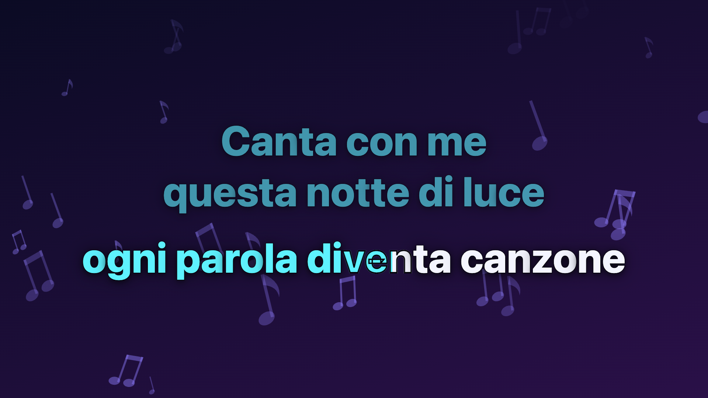 |
| **Regia** (control room) — song, key/tempo/volume, setlist, mixer, SoundFonts, network *(Aurora theme)* | 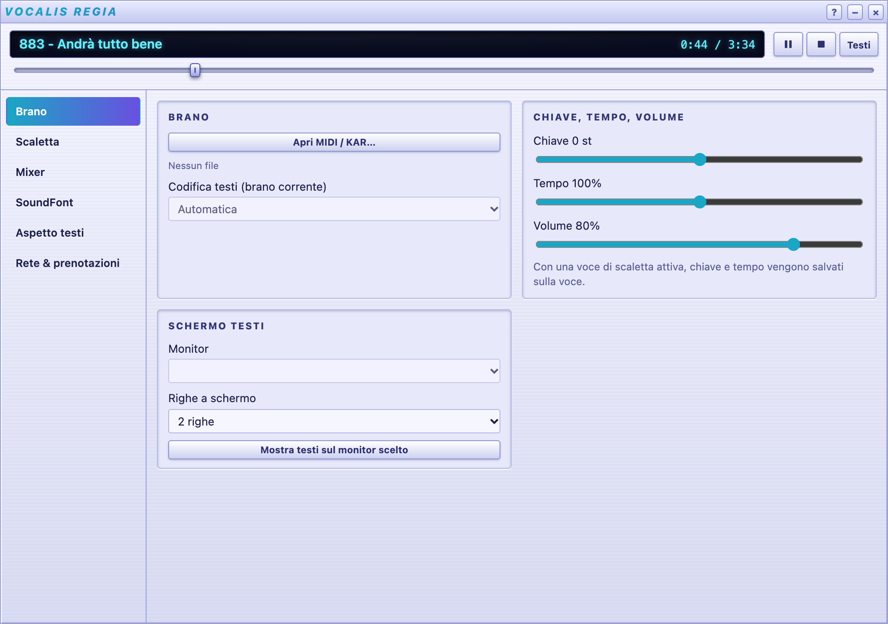 |
| **MIDI Output** — 16 channels with instrument, VU, volume and live notes *(Palco theme)* | 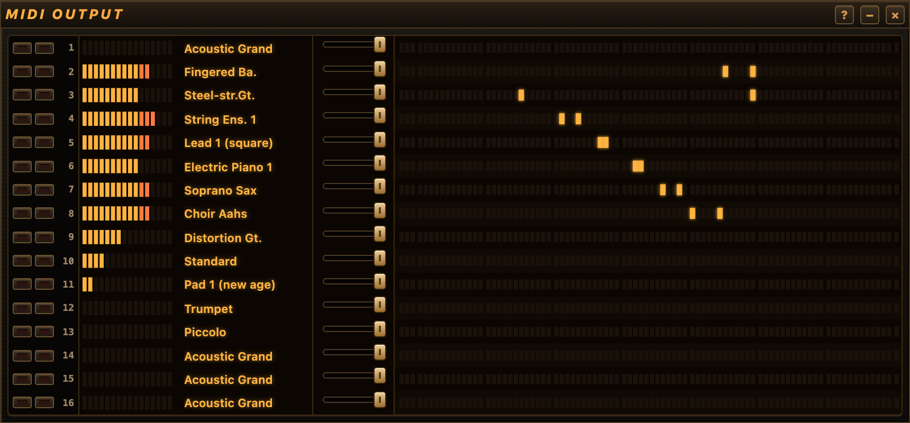 |
| **Piano** — played notes, detected chords, key, live mode *(Palco theme)* | 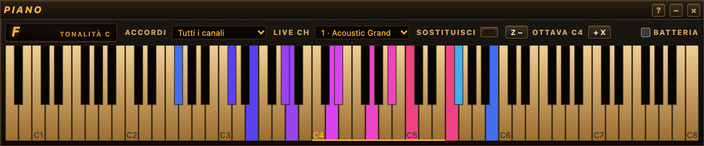 |
| **Library** — search, favorites, recent *(Vocalis theme)* | 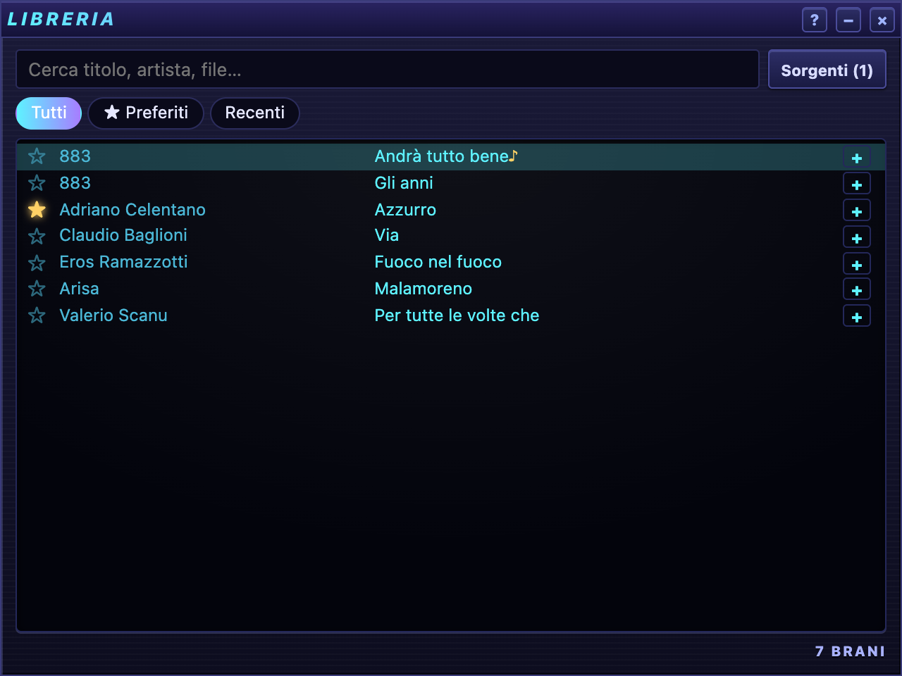 |
| **Setup** — theme picker *(Corallo theme)* | 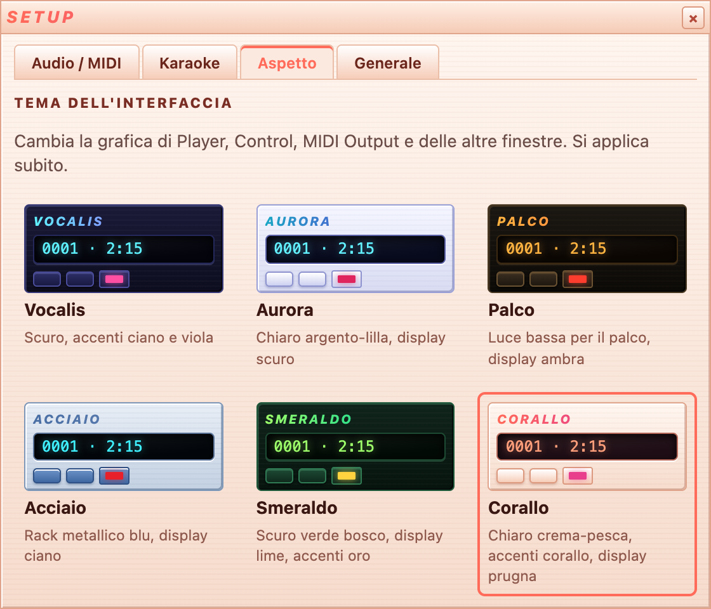 |
| **Setup › Audio / MIDI** — backing track on a virtual port for your DAW (IAC), melody guide and backing vocals to MicTune or other processors *(Palco theme)* | 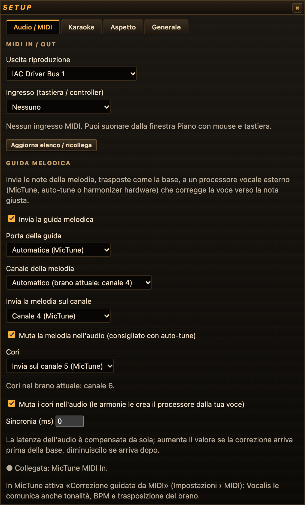 |
| **Playlist** *(Smeraldo theme)* · **Control** *(Acciaio theme)* | 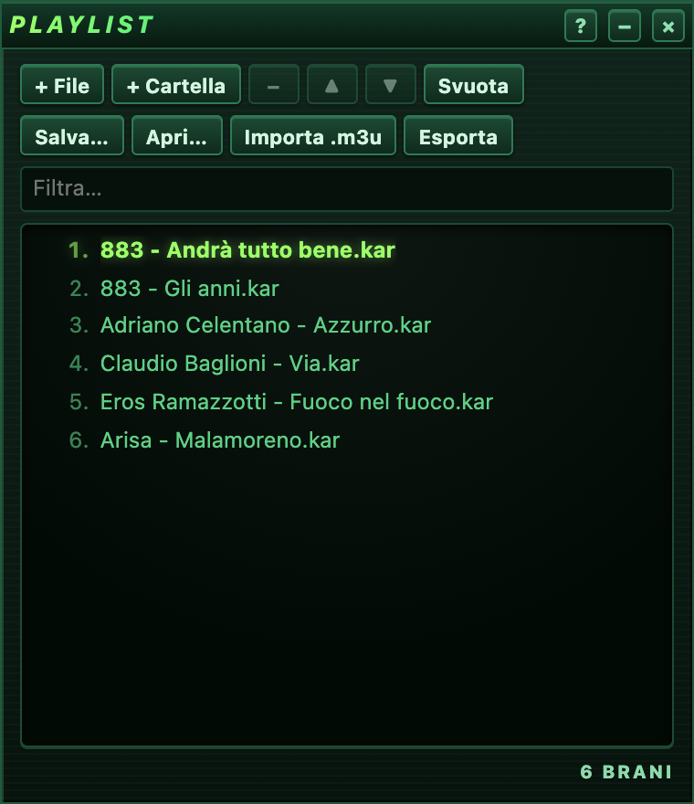 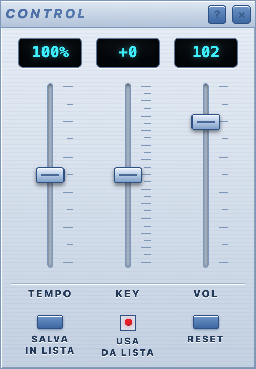 |
| **Mini player** — VU, scrolling title and essential transport *(Smeraldo theme)* | 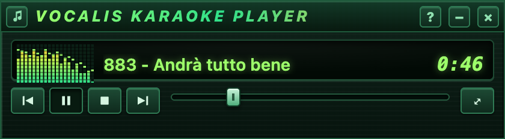 |

### Animated karaoke backgrounds

| Musical notes | Aurora |
|---|---|
|  | 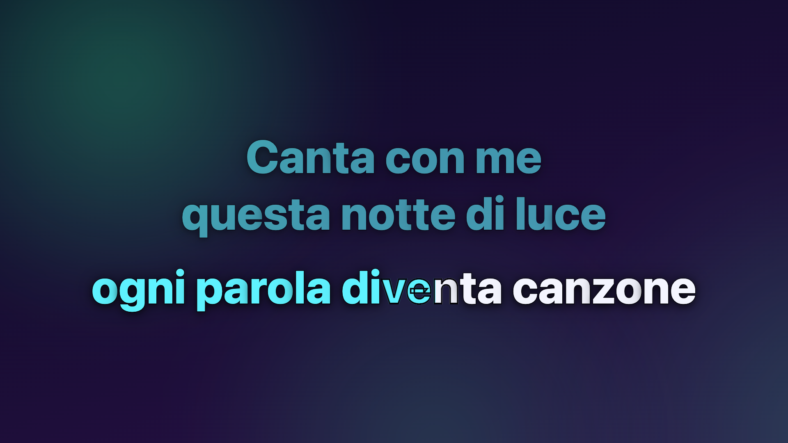 |
| **Stars** | **Music spectrum** |
|  |  |

## Themes

Six built-in themes, applied instantly to every window (♪ menu → Theme, or Setup → Appearance):

| | |
|---|---|
| 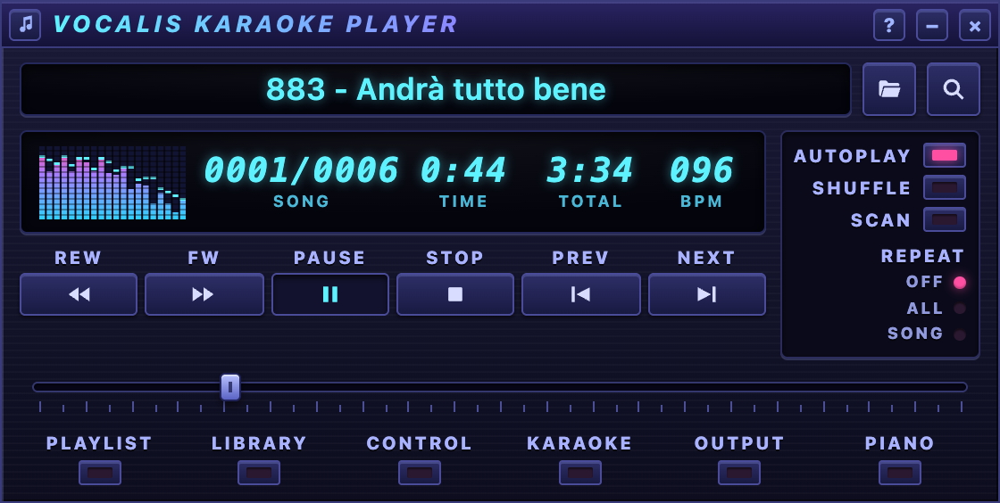 **Vocalis** — dark, cyan and violet accents | 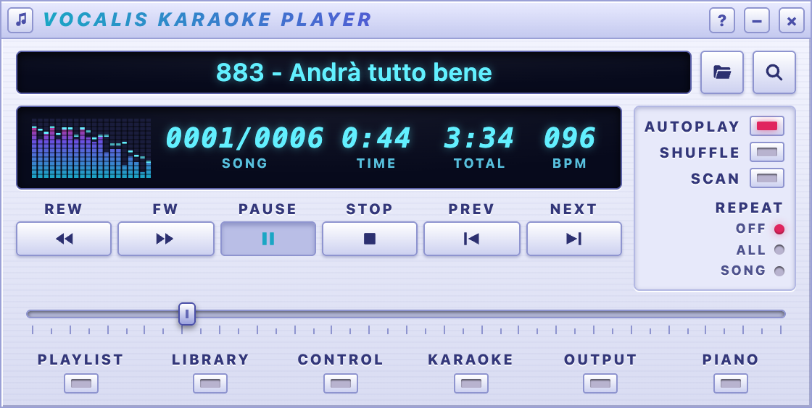 **Aurora** — light silver-lilac |
| 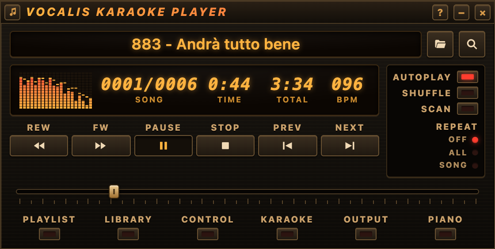 **Palco** — stage low-light, amber display | 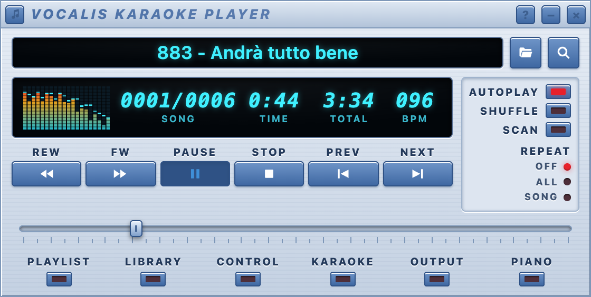 **Acciaio** — blue metal rack |
| 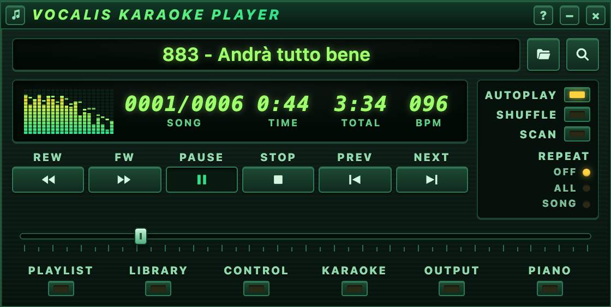 **Smeraldo** — forest green, lime display | 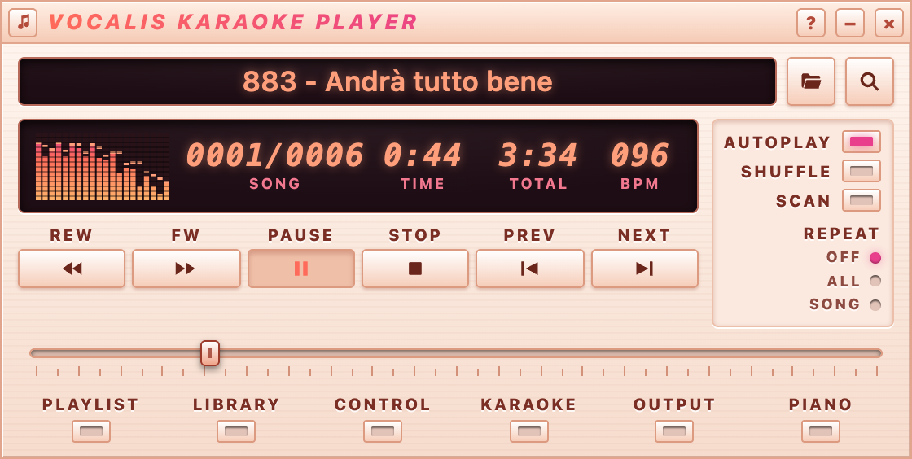 **Corallo** — peach cream, coral accents |

You can make **your own themes**: Setup → Appearance → *Esporta come modello* (Export as template) saves the colors of the active theme to a file you can edit and drop back into the themes folder (*Apri cartella temi*, Open themes folder).

## Getting started

1. **Open a song**: drop a `.kar` or `.mid` file onto the Player (or the Karaoke window), or use the 📂 button.
2. **Show the lyrics**: click **KARAOKE**. In Regia → Brano (Song), pick a monitor to go full screen.
3. **Build your library**: Library → *Sorgenti* (Sources) → add the folders with your files; search becomes instant.
4. **Prepare a setlist**: add songs to the Playlist; key and tempo are saved on each entry.
5. **Sound**: Regia → SoundFont downloads and activates a bank other than the built-in one. In Setup → Audio/MIDI, choose the output: internal synth, system synth or an external MIDI instrument.
6. **Bookings**: Regia → Rete & prenotazioni (Network & bookings) starts the local network service and shows the QR code to put up in the room.

## Keyboard shortcuts

| Shortcut | Action |
|---|---|
| **Space** | Play / Pause |
| **⌘K** (Ctrl+K on Windows/Linux) | Show / hide lyrics |
| **⌘← / ⌘→** | Back / forward 5 seconds |
| **⌘.** | Stop |
| **⌘⇧R** | Open Regia |

## Reporting a problem

Found a bug or have an idea? Open a report in [**Issues**](../../issues), including your operating system, Vocalis version and, if possible, the steps to reproduce the problem.

## Support Vocalis

Vocalis is free and developed in spare time. If you use it at your karaoke nights and want to help it grow (new features, signed installers, more platforms), you can become a sponsor:

Thank you! 🎤

## Credits and licensing

- Vocalis is **free**; its source code is not public. © kikoz85.
- It includes the **GeneralUser GS** SoundFont by S. Christian Collins ([GeneralUser GS License v2.0](https://www.schristiancollins.com/generaluser.php)).
- The other SoundFonts in the catalog are downloaded on request from their original source; each keeps its own license, shown in the app.
- Vocalis **does not distribute any backing tracks**: it plays the user's own files.
- The interface is inspired by the user experience of vanBasco's Karaoke Player, with original artwork. «Roland GS» and «Yamaha XG» are trademarks of their respective owners.
